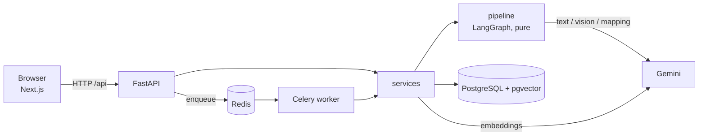

# Document Intelligence: invoice extraction pipeline

Upload invoices as PDF, JPG, PNG, TIFF, XLSX, XLS or CSV. The system extracts the invoice fields to JSON (`null` when unsure, never invented), checks them with plain code, flags problems for manual review, stores everything in PostgreSQL and makes it searchable (keyword, semantic or hybrid).

Care Guide AI Engineer assignment. Demo video: *added at submission*. Repository link: *added at submission*.

> **Honest scope note.** The dataset is synthetic (generated fixtures with known ground truth), and the evaluation is a **partial run** (46 of 93 files, limited by the free Gemini tier). Section 8 and [`docs/evaluation-report.md`](docs/evaluation-report.md) say exactly what ran.

## 1. What it does
- **Ingest:** multi-file upload, type checked by magic bytes, stored by SHA-256 (same bytes are never processed twice).
- **Extract:** a LangGraph pipeline routes each file by type and quality to one of three tiers (parser, OCR, vision) and returns invoices with line items. A file may contain several invoices.
- **Validate:** arithmetic, required fields, dates, currency, duplicates, grounding of every value in the source text. Problems become *issues*, not exceptions.
- **Review:** a Next.js UI shows the source next to the extracted fields and issues; staff can correct values and the invoice is re-validated (no LLM) immediately.
- **Search:** keyword (Postgres full text), semantic (pgvector) or hybrid (reciprocal rank fusion), with supplier/status filters.

## 2. Architecture
Diagrams: [`docs/architecture-diagram.md`](docs/architecture-diagram.md). Dependencies point one way:

```
frontend -> api -> services -> pipeline (pure: file in, result out)
                        \-> db (SQLAlchemy, pgvector)
workers (Celery) -> services
```



`pipeline/` imports nothing from db, api, services, workers, sqlalchemy, fastapi, celery or redis; `backend/tests/unit/test_architecture.py` enforces it.

**Tiers** (the cheapest tier that works wins, vision is the fallback and runs at most once per invoice):

| Tier | Input | Method |
|---|---|---|
| parser | digital PDF pages, spreadsheets | PyMuPDF text and tables (pdfplumber fallback), pandas. Exact, free, milliseconds |
| ocr | scans, images, TIFF frames, garbled pages | RapidOCR (Tesseract fallback), then the LLM reads the OCR text |
| vision | low OCR confidence, blurry images, failed extraction or validation | vision LLM on the page images |

**Per file type:** digital PDFs are labelled page by page, so a mixed PDF sends only its scanned pages through OCR. Spreadsheets: the LLM only sees the column names and about 10 sample rows, maps the columns once, and pandas does every row, so numbers are never retyped by a model; known header layouts skip the LLM via a synonym pass and a DB cache. Corrupt, encrypted or unsupported files end as `failed` with an `error_code`.

## 3. Setup (Windows / PowerShell)
Prerequisites: Python 3.11+, Node 18+, Docker Desktop, a Google AI Studio API key.

```powershell
# 1. config (never commit .env)
cd backend
copy .env.example .env      # then set GOOGLE_API_KEY
docker compose -f ..\docker-compose.yml up -d     # postgres (host port 5433) + redis

# 2. backend
pip install -r requirements.txt
uvicorn app.api.main:app --reload                 # http://localhost:8000/api/health

# 3. worker (second terminal, from backend/)
celery -A app.workers.celery_app worker --pool=threads --concurrency=4 --loglevel=info

# 4. frontend (third terminal)
cd ..\frontend
npm install
npm run dev                                       # http://localhost:3000
```

Notes that matter:
- **Database port:** `docker-compose.yml` publishes Postgres on **5433**, and the code default is 5433. `.env.example` still shows 5432; use `...@localhost:5433/dociq` (and `.../dociq_test` for `DATABASE_URL_TEST`).
- **Model names:** the code defaults (`gemini-2.5-flash`, `gemini-2.5-pro`) returned 404 ("no longer available to new users") for a newly created API key. Set `LLM_MODEL_TEXT=gemini-3.5-flash` and `LLM_MODEL_VISION=gemini-3.5-flash` in `.env`. The Gemini REST endpoint `https://generativelanguage.googleapis.com/v1beta/models` lists what your key can see (a listed model can still return 404 on use).
- Tables are created on startup (`create_all`); there are no migrations.
- Optional: set `API_KEY` to require an `X-API-Key` header (see section 6).

**CLI (no DB, no queue):**
```powershell
cd backend
python -m scripts.generate_fixtures --seed 42 --out data/fixtures
python -m scripts.run_pipeline data/fixtures/*          # table of status, tier, issues per file
python -m scripts.evaluate --no-llm                     # evaluation without any LLM call
```

## 4. API summary
All routes are under `/api`; errors are `{"error": {"code", "message", "fields?"}}`; IDs are UUIDs.

| Method | Path | Purpose |
|---|---|---|
| POST | `/documents` | multipart upload, 1..20 files; 202 with a per-file result (`cached`, `error`) |
| GET | `/documents` | list with `status`, `q`, paging; each row has `current_node` for progress |
| GET | `/documents/{id}` | document, processing events, invoices with lines and issues |
| GET | `/documents/{id}/pages` | stored source text per page with source tier and OCR confidence |
| GET | `/documents/{id}/file` | original file, inline |
| POST | `/documents/{id}/reprocess` | re-run a failed document (`force` for needs_review) |
| GET | `/invoices/{id}` | one invoice |
| PATCH | `/invoices/{id}` | correct fields or lines; re-validates without an LLM; 422 on unparseable values |
| GET | `/search` | `q`, `mode=keyword\|semantic\|hybrid`, filters, paging |
| GET | `/health` | database, Redis, queue depth |

Interactive docs: `http://localhost:8000/docs`.

## 5. Design decisions
Full log with all 16 entries: [`docs/01-architecture.md`](docs/01-architecture.md). The ones that shaped the system:

| Decision | Why | Alternative not taken |
|---|---|---|
| Loader first, LLM second, vision as fallback | exact digits, cost and latency at volume, works when the LLM is down, stored text powers search | send every page to a vision model |
| LLM returns strings as printed; code parses to `Decimal`/date | grounding check is possible, no float or locale errors, **the LLM never does arithmetic** | let the model return numbers |
| Spreadsheets: LLM maps columns once, pandas does rows | constant cost per layout, numbers never retyped | LLM reads all rows |
| Escalate at most once | bounded cost and latency; a human reviews the rest | retry vision until it passes |
| Pipeline is pure; persistence outside | testable in a terminal, queue and DB are swappable | persist inside nodes |
| Expected failures are issues, unexpected bugs are caught by a node wrapper | one bad unit never kills the batch | exceptions for bad input |
| PostgreSQL + pgvector | metadata, text and vectors in one DB; hybrid search in SQL | separate vector DB |
| Celery + Redis | mature, scales by adding workers | in-process background tasks |
| Gemini for text, vision and embeddings; names are env vars | one provider, swappable | multiple providers |
| RapidOCR first, Tesseract fallback | pip-only on Windows, ONNX speed | Tesseract only |
| Docker Compose for infrastructure only | reviewer runs the app in minutes | containerise everything |

## 6. Reliability, scalability, security, performance
**Reliability**
- Idempotent by file hash: re-uploading returns the stored document.
- Every node is timed and wrapped; one failing unit does not stop the others; failed documents can be reprocessed and the previous events are kept.
- Celery: `acks_late`, `task_reject_on_worker_lost`, time limits, retries only for infrastructure errors (not for pipeline results). Indexing failures leave `indexed=false` and a periodic task retries.
- LLM client: retry with back-off on transient errors; quota/config errors become a clear `LLM_CONFIG_ERROR`. If the LLM is down, parser-tier documents still complete.
- A processing result is never silently accepted: `validated_ok` requires every check to pass, anything else is `needs_review` with the reason.

**Scalability** (qualitative; the target is about 1,000 pages/day, roughly 2 pages/minute, so one worker is enough)
- Workers are stateless; the database is the only shared state, so scaling is adding workers. `LLM_CONCURRENCY` and `OCR_WORKERS` raise per-document parallelism.
- Per-page routing: digital pages never touch OCR or vision. Spreadsheets are vectorised pandas.
- Not done: object storage for uploads, table partitioning, per-key rate limiting (listed under future work).

**Security**
- Uploads: allow-list by magic bytes (renamed files are rejected), size cap (`MAX_FILE_MB`), page cap, zip-bomb guard for spreadsheets, 20 files per request. Files are stored under their hash, so the user-supplied name never reaches a path; served with a sanitised name and `X-Content-Type-Options: nosniff`.
- Optional auth: if `API_KEY` is set, every route needs `X-API-Key` (constant-time compare). With no key the API is open for local review. No RBAC or multi-tenancy.
- Secrets only via environment; `.env` is git-ignored. SQL only through SQLAlchemy parameters. Prompts treat document text as data.

**Performance** (measured, in [`docs/evaluation-report.md`](docs/evaluation-report.md); small samples, one machine)
- Spreadsheets are fast: median 0.08 s per sheet file; a 5,000 x 30 sheet took 4.05 s end to end with no LLM call.
- The parser stage of a generated 220-page digital PDF ran at about 158 pages/minute (parser only, no LLM, not end-to-end).
- LLM files take seconds to tens of seconds (a scanned image with a vision fallback took about 16 to 21 s).
- 21 of 22 sheet layouts needed zero LLM calls (synonym pass only; the DB mapping cache was off in the evaluation).

## 7. Testing
```powershell
cd backend
pytest -m "not live"      # offline: fake LLM, no network (database tests need docker compose up)
pytest -m live            # a handful of real Gemini calls
```
Latest offline run ([`docs/test-results.txt`](docs/test-results.txt)): **539 passed, 1 skipped, 1 failed**. The failure is `tests/unit/test_ocr.py::test_t8_parallel_workers_preserve_order`: with `OCR_WORKERS=2` some pages come back with empty text. It passed in two earlier full runs and now fails every time, so it looks like a thread-safety race in the shared OCR engine, not fixed yet (see section 9). Setting `OCR_WORKERS=1` avoids it. Tests are written from each node's spec (`docs/nodes/`) before the code, cover the pipeline, services (real Postgres), API (45 tests) and architecture rules. The frontend is checked with `npx tsc --noEmit` and `npm run build`.

## 8. Evaluation summary
Source: [`docs/evaluation-report.md`](docs/evaluation-report.md), produced by `scripts/evaluate.py` from real pipeline runs (nothing typed by hand).

- **Synthetic dataset**, 93 files and 73 ground-truth invoices, seed 42.
- **Partial run:** 46 of 93 files ran (all the no-LLM files plus about 19 LLM files); 32 were skipped for LLM quota reasons and 15 digital PDFs were not selected. Rates below are over the files that ran.

| Metric (files that ran) | Value |
|---|---|
| Header field accuracy (micro, 8 fields, 38 invoices) | 93.1% |
| Line items precision / recall | 96.0% / 100.0% |
| Invoices fully correct | 22 of 38 (57.9%) |
| Silent errors (validated_ok but wrong) | 1 of 21 (4.8%) |
| Injected errors detected | 7 of 7; false-positive rate on clean invoices 9.1% |
| File status accuracy | 82.6% |
| Processable files that finished | 40 of 40; bad files handled correctly 5 of 6 |
| Multi-invoice segmentation | 1 of 1 file exact (small sample) |

The root-cause analysis of each error is written by the author in the report's section 4; the "Cause" cells are intentionally left blank until then.

## 9. Known limitations and future work
Findings from the evaluation that are **not fixed**:
- `edge_zipbomb.xlsx` ends as `CORRUPT_FILE`; the ground truth expects `TOO_LARGE`.
- `tabular_001.xlsx`, `legacy_001.xls`, `utf8_001.csv` and `cp1252_001.csv` end `needs_review` with `MISSING_REQUIRED(total)`; the ground truth expects `validated_ok`.
- `mixed.pdf` was marked `validated_ok` with a line-item detail wrong (the one silent error).
- `dup_invnum_001/002` report `LINES_MISSING`; `digital_A_003` had arithmetic errors.
- **OCR thread-safety race:** with `OCR_WORKERS=2` (the default) parallel OCR can return empty text for a page (failing test above). Not fixed; `OCR_WORKERS=1` avoids it.
- `pdf_text` took 83 s on the generated 220-page PDF.
- Evaluation limits: partial run, one sample per file, synthetic layouts only, no handwriting, ground truth has few null fields, the sheet-mapping cache and cross-file duplicate detection were off.
- The first 12 LLM files in the evaluation ran while vision returned 404 (see the report header).

Not built: Alembic migrations, RBAC and multi-tenancy, object storage, rate limiting, data deletion/retention, observability. Future work: cross-document verification (PDF to PDF, PDF to Excel), chunked extraction for very large invoices, discounts/shipping/multi-tax, handwriting and multilingual tuning, learning from corrections. More in [`docs/00-skeleton-review.md`](docs/00-skeleton-review.md) and `docs/01-architecture.md`.

## 10. AI-assisted development
Built with Claude (chat) for planning and Claude Code for implementation, plan-first and test-first. What the AI did, what I did and the real bugs it introduced are in [`docs/09-ai-disclosure.md`](docs/09-ai-disclosure.md); the prompts per milestone are in [`docs/prompts-log.md`](docs/prompts-log.md).

## 11. Prior experience
<!-- AUTHOR: one sentence plus a link about your earlier LangGraph invoice-verification project. -->
*(to be added by the author)*

## Documentation index
[`CLAUDE.md`](CLAUDE.md) working rules · [`docs/01-architecture.md`](docs/01-architecture.md) · [`docs/02-schemas.md`](docs/02-schemas.md) · [`docs/04-validation.md`](docs/04-validation.md) · [`docs/06-api-db.md`](docs/06-api-db.md) · [`docs/database-schema.md`](docs/database-schema.md) · [`docs/architecture-diagram.md`](docs/architecture-diagram.md) · [`docs/evaluation-report.md`](docs/evaluation-report.md) · [`docs/test-results.txt`](docs/test-results.txt) · [`frontend/README.md`](frontend/README.md)
