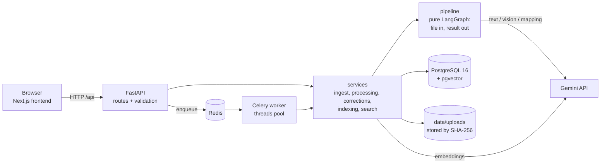
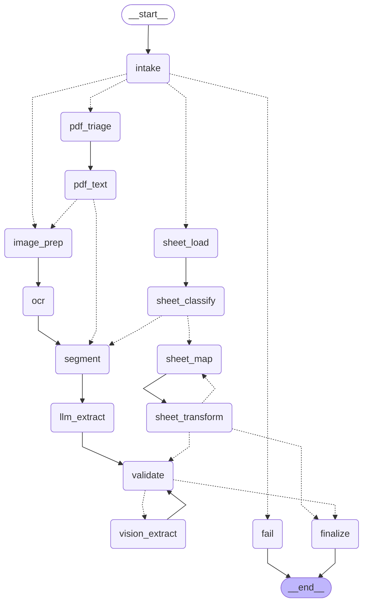

# Architecture diagrams

Sources: [`assets/system.mermaid`](assets/system.mermaid) and [`assets/graph.mermaid`](assets/graph.mermaid).
Dependencies point one way: `frontend -> api -> services -> pipeline / db`. `pipeline/` imports nothing
from db, api, services or workers; `backend/tests/unit/test_architecture.py` enforces that.

## System

## Pipeline graph

Regenerate with `python -m scripts.draw_graph` from `backend/` (writes `assets/graph.mermaid`; the PNG
needs Graphviz `dot`). The `reference/graph_skeleton/graph.png` file is the original skeleton, not the final graph.

