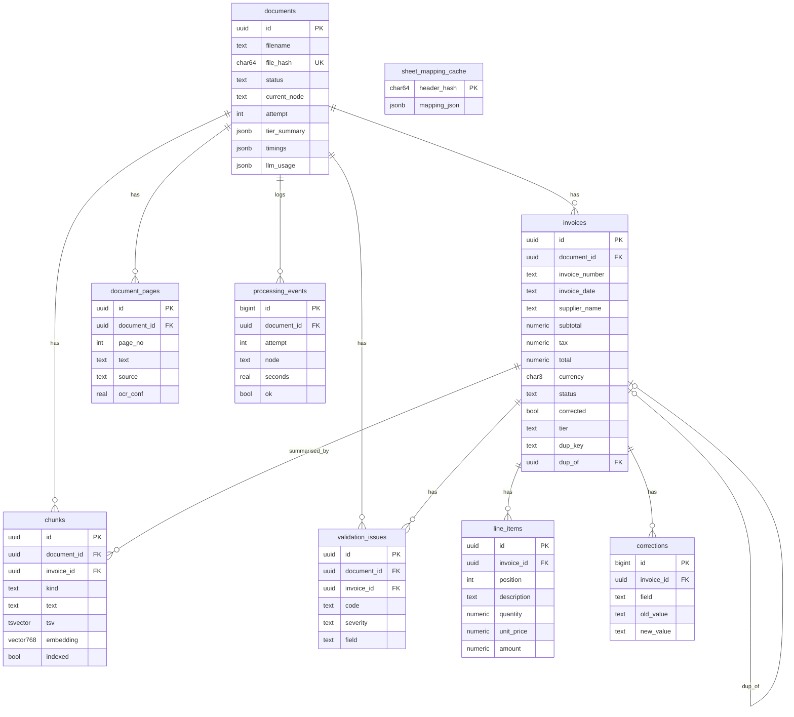

# Database schema

PostgreSQL 16 with the `pgvector` extension (image `pgvector/pgvector:pg16`, see `docker-compose.yml`).
Defined in `backend/app/db/models.py` (SQLAlchemy 2.x). Tables are created on startup with
`Base.metadata.create_all()`; **there are no Alembic migrations** (listed under future work).
Money columns are `numeric(18,4)`, never `float`.

## Tables
| Table | Purpose |
|---|---|
| `documents` | One row per uploaded file. `file_hash` is unique, so re-uploading the same bytes returns the stored document (no reprocessing). `status`: queued, processing, validated_ok, needs_review, failed. |
| `invoices` | One row per extracted invoice (a file can hold several). Holds the parsed header fields, the tier that produced them, `uncertain_fields`, `raw` strings as printed, `source_pages` / `source_rows`, and the duplicate markers. |
| `line_items` | Ordered lines of an invoice (`position`). |
| `validation_issues` | Every problem the validator raised, with code, severity, expected/got, location. Document-level issues have `invoice_id = NULL`. |
| `document_pages` | Source text per page with the tier (`source`) and OCR confidence. |
| `chunks` | Search units: page chunks and one `invoice_summary` chunk per invoice. `tsv` is a generated `tsvector`; `embedding` is `vector(768)`. `indexed=false` until embedded. |
| `processing_events` | One row per pipeline node run (timing, ok flag); drives the progress bar. Kept across reprocessing attempts. |
| `corrections` | Audit log of manual edits (old and new value per field). |
| `sheet_mapping_cache` | Column mapping per header hash, so a known spreadsheet layout needs no LLM call. |

## Indexes and constraints
- `documents.file_hash` unique.
- `invoices`: indexes on `supplier_name`, `invoice_date`, `status`, `document_id`.
- `uq_invoice_dupkey`: partial unique index on `invoices.dup_key` where `dup_key IS NOT NULL AND status <> 'failed'`. Only the first accepted copy keeps its `dup_key`; a later duplicate is stored with `dup_key = NULL` and `dup_of` pointing at the original, and gets a DUPLICATE_INVOICE issue.
- `chunks`: GIN index on `tsv` (keyword search) and an HNSW index on `embedding` with cosine ops (semantic search).
- Child tables use `ON DELETE CASCADE` from their document or invoice; `invoices.dup_of` uses `SET NULL`.

## Where the code differs from docs/06
docs/06 is the original design; the code is the truth. Differences found when this file was written:
- `invoices.invoice_date` and `due_date` are stored as **text** (ISO `YYYY-MM-DD`), not `date`.
- An extra table, `sheet_mapping_cache`, exists for the header-hash cache.
- Python type hints on the money columns say `float`, but the column type is `Numeric(18,4)` and values pass through `Decimal` in the pipeline. This is a typing wart, not a storage issue.
